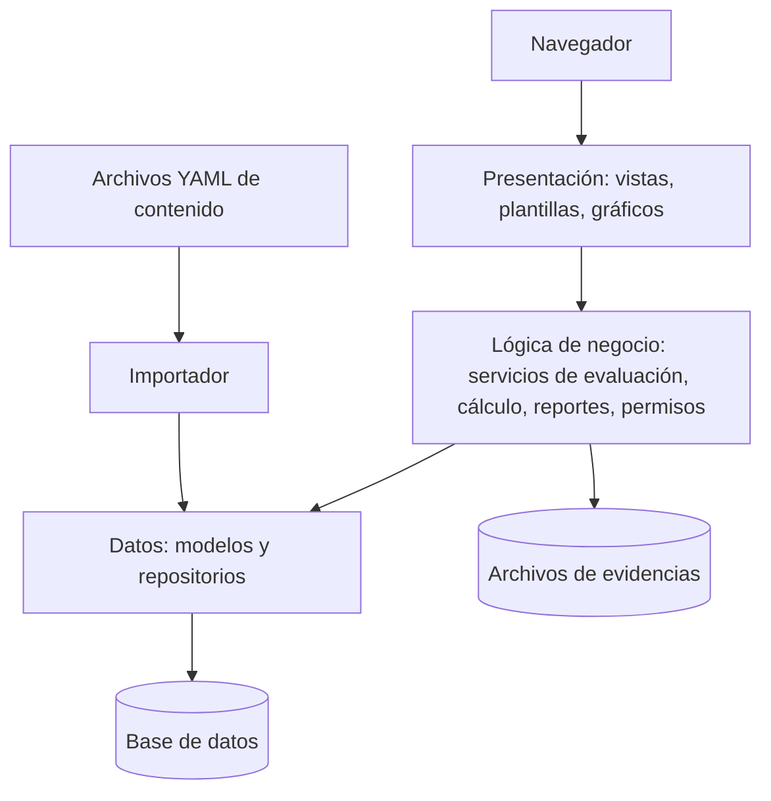

# Arquitectura

La guía deja la arquitectura libre y exige separar al menos presentación, lógica de negocio y datos. El sistema es un monolito web en capas ([ADR-001](../06-decisiones/adr-001-monolito-en-capas.md)).

## Capas



| Capa | Responsabilidad | No debe |
|---|---|---|
| Presentación | Recibir peticiones, validar formularios, renderizar | Calcular porcentajes ni estados |
| Negocio | Fórmula, estados, brechas, historial, reportes, reglas de rol | Conocer HTML |
| Datos | Persistir y consultar | Contener reglas de la norma |

El cálculo de porcentaje y estado vive en funciones puras, sin acceso a la base, para probarlo de forma aislada.

## Las capas en Django

| Capa | Elementos |
|---|---|
| Presentación | Vistas, formularios, plantillas, HTMX y Chart.js |
| Negocio | Módulos `servicios/` de cada app |
| Datos | Modelos, migraciones y ORM sobre SQLite |

La autenticación usa el sistema de usuarios de Django. El panel de administración de Django sirve de base para M7 y respeta los roles del sistema. El importador de YAML es un comando de gestión (`manage.py`).

## Estructura de código

Sigue el [stack](stack.md).

```
iso_board_29110/
├── config/            # configuración del proyecto
├── apps/
│   ├── catalogo/      # M1, M2, M3: familias, normas, apartados, ítems
│   ├── evaluaciones/  # M4, M5: organizaciones, evaluaciones, evidencias
│   │   └── servicios/ # cálculo y estado (funciones puras)
│   ├── reportes/      # M6
│   └── cuentas/       # M7: usuarios y roles
├── contenido/         # YAML de normas y listas
├── templates/
├── static/
├── tests/
├── docs/
└── README.md
```

## Extensibilidad

Familia, norma, apartado e ítem son datos. Ningún código de norma, proceso o perfil de la 29110 se escribe fijo en el código, de modo que ISO 9001 o ISO/IEC 25010 se registran desde administración. El mapa gráfico se genera a partir de los datos.

## Seguridad

- Contraseñas con hash y sal, usando el mecanismo del framework.
- Permisos verificados en el servidor en cada operación de escritura.
- Evidencias: limitar tamaño y extensiones, renombrar al guardar y servir solo a usuarios autenticados.
- Evidencias de tipo enlace: aceptar solo `http` y `https`.
- Secretos en variables de entorno, fuera del repositorio.
