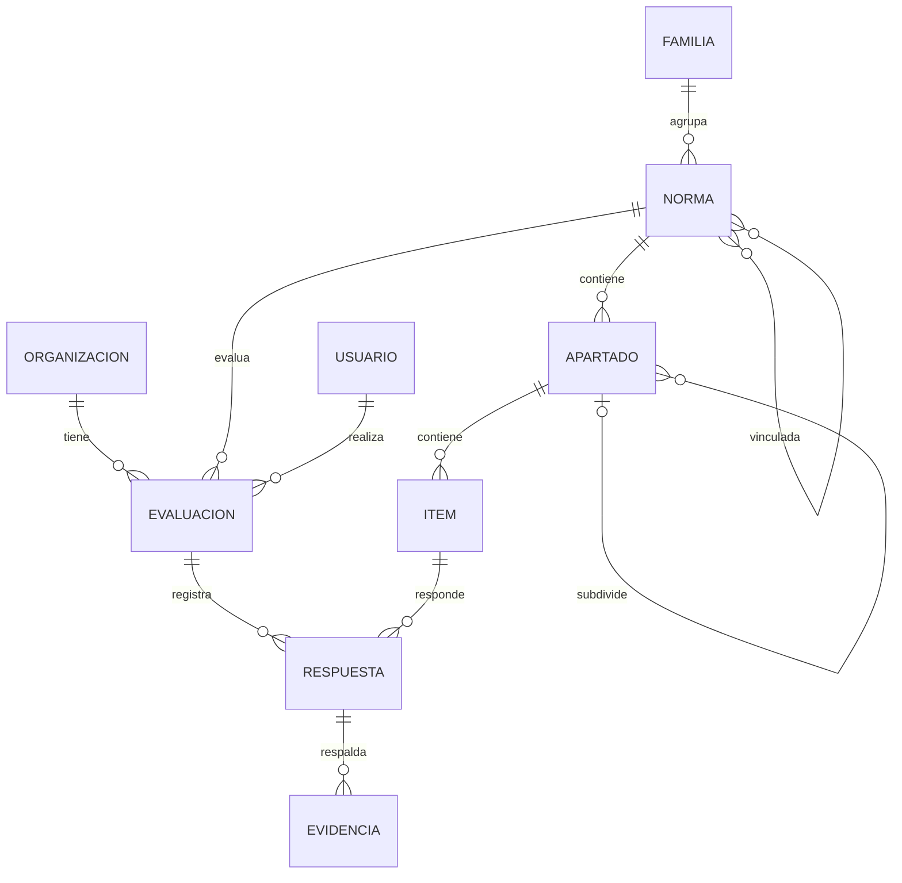

# Modelo de datos

Parte de las nueve entidades mínimas de la tabla 5. Los campos marcados con `+` son ampliaciones, y la guía exige justificarlas en el diagrama entidad-relación del informe técnico.

## Diagrama entidad-relación

## Diccionario de datos

### Familia

| Campo | Tipo | Reglas |
|---|---|---|
| id | entero | PK |
| nombre | texto | Único, ej. ISO/IEC 29110 |
| descripcion | texto largo | |

### Norma (parte)

| Campo | Tipo | Reglas |
|---|---|---|
| id | entero | PK |
| familia_id | FK Familia | Obligatorio |
| codigo | texto | Único por familia |
| titulo | texto | |
| edicion | texto | Admite "2018 + Amd 1:2025" |
| tipo | texto (catálogo) | Visión general, perfiles, evaluación y certificación, guías |
| audiencia | texto | |
| introduccion | texto largo | Redacción propia |
| enlace_oficial | URL | |
| tipo_acceso | enumeración | gratuito, pago, institucional |
| proposito `+` | texto | Pedido en M2 |
| contenido_principal `+` | texto largo | Pedido en M2 |
| perfiles `+` | lista | Perfiles relacionados (M2) |
| normas_vinculadas `+` | N:M Norma | Pedido en M2; alimenta el mapa |
| fuentes `+` | texto largo | Pedido en RF-02 |
| enlace_verificado_el `+` | fecha | La guía exige verificar cada enlace |

### Apartado

| Campo | Tipo | Reglas |
|---|---|---|
| id | entero | PK |
| norma_id | FK Norma | Obligatorio |
| padre_id `+` | FK Apartado | Permite proceso, actividad y tarea (RF-06, RF-09) |
| tipo `+` | enumeración | proceso, actividad, sección |
| codigo | texto | Ej. GP.1; único por norma |
| nombre | texto | |
| orden | entero | |

### Ítem de verificación

| Campo | Tipo | Reglas |
|---|---|---|
| id | entero | PK |
| apartado_id | FK Apartado | Obligatorio |
| codigo | texto | Ej. GP.1.1; único por norma |
| enunciado | texto | |
| producto_esperado | texto | |
| rol_responsable | texto | Uno o varios (GP, LT, CL...) |

### Organización o proyecto

| Campo | Tipo | Reglas |
|---|---|---|
| id | entero | PK |
| nombre | texto | Obligatorio |
| numero_personas | entero | Mayor que 0; advertir si supera 25 (propuesta) |
| perfil_objetivo | texto (catálogo) | Entrada, Básico, Intermedio, Avanzado |

### Evaluación

| Campo | Tipo | Reglas |
|---|---|---|
| id | entero | PK |
| organizacion_id | FK Organización | |
| norma_id | FK Norma | |
| evaluador_id | FK Usuario | |
| fecha | fecha | |
| porcentaje | decimal | Calculado; puede quedar vacío si no hay ítems aplicables |
| estado | enumeración | Calculado según RN-02 |
| cerrada `+` | booleano | Una evaluación cerrada no se edita (historial, RF-14) |

### Respuesta

| Campo | Tipo | Reglas |
|---|---|---|
| id | entero | PK |
| evaluacion_id | FK Evaluación | |
| item_id | FK Ítem | Único junto con evaluacion_id |
| valor | enumeración | C, P, NC, NA; vacío si no se ha evaluado |
| observacion | texto | |
| responsable | texto | |
| fecha | fecha | |
| accion_mejora `+` | texto | Pedido en RF-12 |

### Evidencia

| Campo | Tipo | Reglas |
|---|---|---|
| id | entero | PK |
| respuesta_id | FK Respuesta | |
| tipo | enumeración | archivo, enlace |
| ruta | texto | Ruta del archivo o URL |
| descripcion | texto | |

### Usuario

| Campo | Tipo | Reglas |
|---|---|---|
| id | entero | PK |
| nombre | texto | |
| correo | texto | Único |
| rol | enumeración | administrador, evaluador, consultor |
| contrasena | texto | Solo hash |

## Integridad

- Los catálogos de tipo de norma y perfil se guardan como datos para admitir otras familias.
- No permitir eliminar un ítem o una norma con respuestas registradas; desactivarlos para no romper el historial (propuesta).
