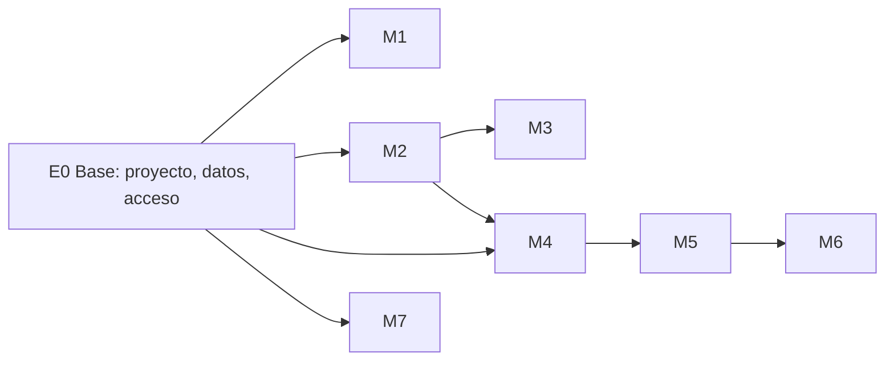

# Módulos

| Módulo | Descripción | Funciones mínimas | Requisitos | Obligatorio para aprobar | Peso en rúbrica |
|---|---|---|---|---|---|
| M1. Biblioteca o guía | Presenta la familia como un libro navegable organizado por grupos de documentos | Índice general, navegación por capítulos, buscador por palabra clave y mapa de la familia | RF-01, RF-03 | Sí | 20 % (con M2) |
| M2. Ficha de cada norma | Detalle de cada parte | Código, título, edición vigente, propósito, introducción, audiencia, perfiles relacionados, contenido principal y normas vinculadas | RF-02 | Sí | |
| M3. Acceso al documento | Obtener el documento oficial | Botón "Descargar o consultar norma" con enlace oficial o copia institucional autorizada | RF-04 | Sí | 10 % |
| M4. Lista de verificación | Evaluar el cumplimiento por apartado | Marcar C, P, NC, NA; evidencias, responsables, fechas y observaciones | RF-05 a RF-08 | Sí | 20 % |
| M5. Tablero de estado | Avance por norma y organización | Porcentaje, estado, gráficos y brechas pendientes | RF-09 a RF-12, RF-14 | Sí | 15 % |
| M6. Reportes | Documentos de resultados | Exportar el estado de cada norma a PDF o hoja de cálculo con fecha y responsable | RF-13 | No | 10 % (con M7) |
| M7. Administración | Contenido y usuarios | Alta, edición y eliminación de normas, apartados e ítems; roles administrador, evaluador y consultor | RF-15 | No | |

## Dependencias

La autenticación y los roles (RNF-03) se construyen en E0, aunque la administración completa pertenezca a M7.
